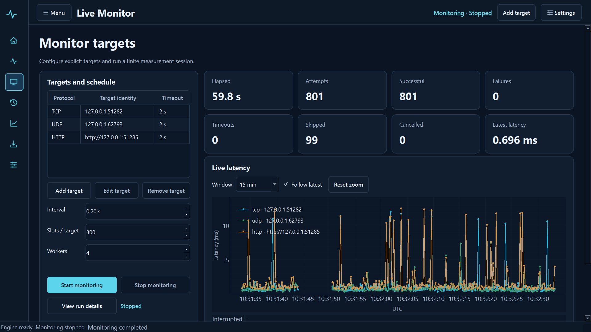

# NetCraft

NetCraft is a desktop and command-line tool for diagnosing network endpoints and
monitoring them over time. It measures connection, TLS and application response
stages and keeps results in local SQLite history. Its measurements can inform
troubleshooting. They offer no guarantee of improving network performance.



## What you can do

- Check a TCP connection, run the local TCP or UDP echo lab, or inspect a DNS
  response. On Windows, an empty resolver field uses the Windows DNS Client.
  You can also specify an IPv4 or IPv6 resolver and port.
- Diagnose HTTP and HTTPS with GET or HEAD. View status, handshake and request
  timings, and verified TLS details. Use an explicit CA file for a private CA
  or test fixture.
- Monitor configured endpoints with finite schedules and bounded workers.
  Defaults are a five-second interval, ten slots per target and four workers.
- Browse saved runs, compare latency and reliability, and export CSV or JSON
  containing runs, filtered samples, summaries or latency trends.
- Use seven desktop pages for Overview, Diagnostics, Live Monitor, History,
  Analytics, Export and Settings.

[HTTPS screenshot](docs/phase-4-5-evidence/verified-https.png) ·
[Desktop guide](docs/desktop-studio.md)

## Install and launch

NetCraft v0.5.0 is a source-only release. The portable Windows ZIP and installer
are unavailable for this release. [Release notes](docs/release-notes-0.5.0.md)

Use Python 3.12 or newer. Extract the GitHub source archive or clone the
repository. From the source root in PowerShell, use the version selector for
your installed Python. This example uses 3.12.

```powershell
py -3.12 -m venv .venv
.\.venv\Scripts\python.exe -m pip install '.[gui]'
.\.venv\Scripts\netcraft-gui.exe
```

For a CLI-only install, run `.\.venv\Scripts\python.exe -m pip install .`.
The desktop extra installs Qt and plotting dependencies through pip.
`python -m netcraft` runs the CLI and `python -m netcraft.gui.main` opens the
GUI from the selected environment.

## CLI examples

```powershell
$netcraft = '.\.venv\Scripts\netcraft.exe'
& $netcraft tcp-echo 'hello TCP' --json
& $netcraft udp-echo 'hello UDP' --json
& $netcraft dns localhost --type A --json
& $netcraft http https://example.com --method HEAD --json
```

The echo commands create and close their own loopback listeners. For monitoring,
the examples below expect a TCP or HTTP service already listening on local port 8000.

```powershell
$history = Join-Path $env:LOCALAPPDATA 'NetCraft\example-history.sqlite3'
$run = & $netcraft monitor --db $history --tcp 127.0.0.1:8000 --http http://127.0.0.1:8000/status --interval 2 --samples 5 --json | ConvertFrom-Json
& $netcraft history --db $history --run $run.run.run_id --limit 10
& $netcraft summary --db $history --run $run.run.run_id --group target
& $netcraft export --db $history --report trend --format csv
```

`--duration` sets a time budget in place of a slot count. Ctrl+C requests
cancellation. Exit codes include `0` for a completed diagnostic, `1` for an
operational failure, `2` for invalid input and `130` for interruption. An HTTP
error response or an empty DNS answer can still be a completed diagnostic.

## Architecture

`protocols/` and `diagnostics/` implement probes and the loopback lab. The Python
standard library handles sockets, deadlines and TLS. dnspython handles DNS wire
messages, with a Windows DNS Client adapter for system resolver policy.
`monitoring/` schedules bounded jobs, records versioned telemetry in SQLite and
computes summaries. The CLI and the PySide6 desktop use the same engine. The GUI
runs work off the Qt thread and uses PyQtGraph for charts.

[Networking engine](docs/network-engine.md) · [DNS](docs/dns-diagnostics.md) ·
[HTTP and TLS](docs/http-tls-diagnostics.md) · [Monitoring](docs/monitoring.md) ·
[Timing methodology](docs/timing-methodology.md)

## Local data and privacy

Opening NetCraft or switching pages starts no network probes. Choose targets
explicitly and test only endpoints you are authorized to use. The application
keeps history locally at `~/.netcraft/history.sqlite3` and stores default Windows
preferences for the current user. These locations are separate from the source checkout.
An existing profile keeps its history. For disposable testing, launch with both
`--history path\to\test.sqlite3` and `--settings path\to\test.ini`.

History stores HTTP origins and sanitized telemetry. It excludes credentials,
paths, query strings, response headers and bodies. Exports go to a path you
choose. Retention previews and overwrite or deletion confirmations protect
existing files and observations. Keep exported target identifiers and timings
private when appropriate.

## Testing, performance and platform scope

```powershell
.\.venv\Scripts\python.exe -m pip install -e '.[dev,gui,gui-test]'
.\.venv\Scripts\python.exe -m pytest -q
.\.venv\Scripts\python.exe -m ruff check .
.\.venv\Scripts\python.exe -m ruff format --check .
.\.venv\Scripts\python.exe -m mypy --strict
.\.venv\Scripts\python.exe -m pip check
```

The suite uses loopback sockets and ephemeral TLS certificates. On the verified
Windows desktop, the Phase 4.5 run accounted for 900 slots in about 60 seconds,
with 801 successes and 99 skips at a 200 ms cadence. The bulk fixture exported
150,000 rows to CSV and JSON and matched both files to SQLite. These are measured
local workloads. [Benchmark and acceptance evidence](docs/phase-4-5-final-desktop-acceptance.md)

Desktop verification targets Windows 11 x64. Other Windows versions, Windows on
ARM, Linux and macOS desktop behavior, and live VPN or split DNS configurations
remain unverified. At 150% scale on the tested display, a 1920×1080 logical window
exceeds the available work area. A blocking system hostname lookup can delay
cancellation. Use locally generated or trusted SQLite history files.

## License

NetCraft is available under the [MIT License](LICENSE). Optional dependencies
use their upstream licenses. [Third-party notices](THIRD_PARTY_NOTICES.md)
